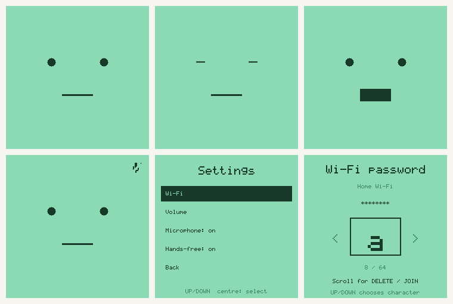

# Digimon - a small voice companion for your ChatGPT dot

A device-only voice prototype for the attached **Quipus Original / lantern-original**, model **ZHENGCHEN-1.54-M1307**: ESP32-S3, 16 MB flash, 8 MB octal PSRAM, ST7789 display, microphone and speaker. Its observed USB port is **COM6, 115200 baud**. Firmware uses ESP-IDF **5.2.3**.

**Status, 17 October 2026:** firmware **0.2.0 compiled successfully** for ESP32-S3. It adds a mint face, PCM-driven mouth animation, three-button Wi-Fi setup, volume, physical microphone mute, persistent preferences and experimental natural activation. Flashing and live account verification are recorded separately in `BUILD_REPORT.md`.

Everyday runtime is **ESP32 ↔ OpenAI**. No Agora, custom server, dashboard, web app, or companion app runs between them. A computer is needed once to install/configure firmware and connect the plugin in OpenAI's existing settings. After setup, the device uses saved 2.4 GHz Wi-Fi and battery power.



## Device controls

| Gesture | Normal screen | Settings |
|---|---|---|
| Up / down | Volume in 5% steps | Move through choices/characters; hold to scroll |
| Centre tap | Start/stop manual recording; interrupt pending work | Select/add character |
| Hold centre | Open settings | Go back; discard unfinished input |
| Hold both side buttons | Toggle microphone mute | Same physical mute control |

Settings contains Wi-Fi, volume, microphone and hands-free mode. Choose Wi-Fi to scan nearby networks. Select a network or enter a hidden SSID, then use the character picker for the password. Its final choices are Delete, Join and Cancel. All printable ASCII characters are supported; passwords are masked. Saving Wi-Fi restarts the device with the new network. No browser or companion app is used for this process.

The face has two dot eyes, blinking and a straight idle mouth. Mouth movement follows PCM being played, including the selected volume. A small indicator shows listening/muted state. Software mute stops capture and clears queued speech; it does not disconnect the microphone electrically.

## What happens when you speak

1. With hands-free enabled and the account connected, local energy detection retains 350 ms of preceding audio and captures a speech candidate, up to 15 seconds. Manual recordings bypass the address classifier.
2. ESP32 uploads a WAV to OpenAI transcription. A Responses API request classifies hands-free transcripts as addressed, ambient or uncertain using aliases and recent accepted context. This happens after upload, so ambient speech may also reach OpenAI.
3. Accepted speech becomes a signed `device.utterance` event to the subscribed dot; other speech stays quiet.
4. Your dot calls `reply_to_device(request_id, text)` through the private tunnel.
5. ESP32 requests OpenAI speech and plays it. Centre tap cancels pending work. A 45-second follow-up window permits contextual continuation without a fixed wake phrase.

Hands-free capture pauses during playback and settings. Local detection is experimental amplitude segmentation; the cloud classifier supplies meaning-based addressing. TV audio, another person or quiet speech can cause mistakes. This is not speaker identification. See [personality and listening behavior](docs/PERSONALITY.md) for the dot instructions, limits and saved preferences.

This is an asynchronous event/tool exchange with your existing dot. It is not ChatGPT's native voice-call protocol. Audio API usage is billed separately from a ChatGPT subscription.

## 1. Build and install

Open PowerShell in this folder. Use ESP-IDF 5.2.3 and its ESP32-S3 tools:

```powershell
.\tools\build.ps1
# If using an existing SDK installation:
.\tools\build.ps1 -IdfPath C:\path\to\esp-idf -IdfToolsPath C:\path\to\idf-tools
```

This workspace already has the SDK/toolchain under `work/`. Its isolated SDK has a three-line compiler-path adjustment for Windows paths containing spaces; the build wrapper reads the SDK without modifying it. For a fresh SDK installation, use paths without spaces. The bundle records compiled settings and SHA-256 hashes for the source and artifacts.

First flashing is separate from provisioning. The included flash script requires an explicit switch, checks the existing partition layout, and backs up the full 16 MB flash before an app write:

For this CH340K board, first turn the device fully off, unplug USB, hold the large centre/BOOT button, and reconnect USB while keeping BOOT held. Release BOOT once the script connects. The script uses `no_reset` because this board's automatic download-mode entry is unreliable. Tap the small RESET/EN button after writing if the display does not restart.

```powershell
.\tools\flash.ps1 -Port COM6 -Flash
```

Keep the original backup private: it includes credentials from the installed firmware. The flasher writes the app at `0x20000` and resets the existing OTA selection to boot that slot; it preserves the bootloader, partition table, model partition and NVS. Keep USB power stable during flashing. Do not erase NVS or substitute another board profile. Close any serial monitor before using these scripts. `provision.ps1` never flashes firmware.

Preserved hardware: microphone WS/SCK/DATA **4/5/6** at 16 kHz; speaker DATA/BCLK/LRCK **7/15/16** at 24 kHz; main/down buttons **0/39**; power hold **2**; charge signal **9**. Display wiring is in `main/boards/lantern_original.h`.

## 2. Create a dedicated private OpenAI tunnel

In your intended personal OpenAI account:

1. Open [Platform tunnel settings](https://platform.openai.com/settings/organization/tunnels). Create or reuse a tunnel associated with your intended **personal Platform organization and personal ChatGPT workspace**. Preserve its complete `tunnel_id`.
2. Ensure the tunnel operator/runtime principal has **Tunnels Read + Use**; tunnel creation additionally needs Manage. Obtain a restricted runtime API key, **not an Admin key**, from [Platform API keys](https://platform.openai.com/settings/organization/api-keys).
3. Check that your ChatGPT account permits a custom MCP server and MCP Events for dots. Account/workspace availability must be verified in the actual account.

This build uses ChatGPT's **NoAuth** option inside an authenticated private tunnel. The tunnel's OpenAI access controls are the authorization boundary: **every principal granted Use of this tunnel is trusted to control the device and its subscription**. Use a dedicated personal tunnel; do not associate it with shared organizations/workspaces or grant others Use. The firmware does not receive a documented verified individual ChatGPT user ID.

The explicit provisioning switch `-TunnelScopeAuth` enables this mode. Optional bearer support exists in firmware for other compatible clients; ChatGPT's documented custom MCP form does not provide arbitrary bearer-key entry. See [custom MCP setup](https://developers.openai.com/api/docs/guides/custom-mcp-server) and [Secure MCP Tunnel](https://developers.openai.com/api/docs/guides/secure-mcp-tunnels).

## 3. Configure Wi-Fi and tunnel over USB

Start with a text test so the dot connection can be proved without audio credentials:

```powershell
.\tools\provision.ps1 -Port COM6 -Action Configure -TunnelScopeAuth -TextOnly
```

The script verifies the new firmware's board/version, then prompts for SSID, masked Wi-Fi password, tunnel ID and masked runtime key. It sends configuration directly to the ESP32, includes the computer's current UTC time, and waits for restart. **Keys/passwords are never placed in command arguments, printed, or saved to a local configuration file.** Credentials are stored on the device; this personal prototype does not enable production flash encryption or secure boot.

Ensure the computer's date is correct. The ESP32 uses USB/persisted time to bootstrap certificate verification, then obtains fresh time from verified OpenAI HTTPS responses; it uses no separate NTP service.

```powershell
.\tools\provision.ps1 -Port COM6 -Action Status
```

Before creating the ChatGPT plugin, expect `wifi_connected`, `clock_fresh`, and `tunnel_connected` to become `true`; normal tunnel poll status is **200 or 204**. In text-only mode, `audio_ready: false` is expected.

## 4. Connect the actual dot

In **ChatGPT Plugins → Add custom MCP server**:

- Give it a name such as `My ESP32`.
- Set **Connection: Tunnel**, choosing the same tunnel ID.
- Set **Authentication: NoAuth** and finish creating the private plugin.
- Discover its four tools and call **`device_status`**. Confirm `device_id: quipus-original-01`. Read or update saved names, aliases and response style with `get_device_preferences` and `update_device_preferences`; neither can remotely unmute the microphone.

Ask your intended dot:

> Subscribe to the My ESP32 plugin's device.utterance event for device_id quipus-original-01. When an utterance arrives, answer it by calling reply_to_device with the event's original request_id and your reply text. Keep spoken replies concise.

Verify `subscription_ready: true`, then test a complete round trip:

```powershell
.\tools\provision.ps1 -Port COM6 -Action Say -Text "Hello from my ESP32" -WaitForReplySeconds 120
```

The returned USB reply must carry the request ID for that message. This test is what establishes that your existing dot received the event and called back. A configured plugin or successful poll alone does not establish that.

## 5. Enable microphone and speaker

Run configuration again without `-TextOnly`:

```powershell
.\tools\provision.ps1 -Port COM6 -Action Configure -TunnelScopeAuth
```

Provide the same Wi-Fi/tunnel settings and an OpenAI API key with transcription, speech and Responses API access. Defaults are `gpt-transcribe`, `gpt-4o-mini-tts`, and voice `coral`; the script supports `-TranscriptionModel`, `-SpeechModel`, and `-Voice` if your project needs another supported option. The API key does not select a dot; the plugin's event subscription does.

Check status, tap the centre button to start/stop a recording, and confirm the spoken reply. Then test hands-free addressing with the on-screen listening indicator visible. You can then disconnect the computer. USB is only needed for later provisioning or diagnostics.

```powershell
.\tools\provision.ps1 -Port COM6 -Action Cancel
```

## Troubleshooting and limits

- **No firmware response / port busy:** select the actual COM port and close other serial software. The provisioner accepts only this project's `lantern-original`, version `0.2.0` status response.
- **Tunnel HTTP 401/403:** correct the runtime key, permissions, tunnel associations and workspace access, then reprovision/restart.
- **`tunnel_active_organization_required`:** explicit organization-header configuration is not implemented in this build. This account setup needs that extension before it can connect.
- **`subscription_ready: false`:** connect/subscribe the intended dot, or renew an expired subscription. The firmware supports signed verification, refresh and key rotation, but a live client must manage its subscription.
- **`delivery_uncertain` / pending request:** delivery may have succeeded before a network timeout. Cancel explicitly before starting another request.
- **Clock or certificate failure after a long power-off:** rerun USB configuration with current computer time.
- **No spoken reply:** verify `audio_ready`, audio API permissions/billing, supported model/voice, and hardware playback. Keep the first test in text-only mode to isolate account/tunnel setup.

The tunnel client accepts bounded text/tool payloads up to 128 KiB, uses one command at a time, and has no public network listener. Speech requests go directly to the separate OpenAI audio APIs. Private tunnel ACL mode does not provide user isolation within a shared workspace.

This first build supports one event subscription and public IPv4 HTTPS callbacks on port 443. It does not persist or replay pending utterances after a restart. Local cancellation stops subsequent audio/delivery attempts; an event already accepted by OpenAI can still be processed. Callback I/O has an overall deadline, but the underlying synchronous DNS lookup can exceed it before returning.

## Protocol provenance and verification

The tunnel wire implementation follows OpenAI's published [protocol.md](https://github.com/openai/tunnel-client/blob/3e52fa0400c9126dbc92c6b764b4e712506927cf/docs/protocol.md) and [OpenAPI contract](https://github.com/openai/tunnel-client/blob/3e52fa0400c9126dbc92c6b764b4e712506927cf/docs/openapi.json), pinned to **`3e52fa0400c9126dbc92c6b764b4e712506927cf`**. It is an independent embedded implementation, not an official ESP32 SDK. MCP2/Event behavior follows the official source schemas used in validation and [OpenAI MCP Events documentation](https://developers.openai.com/plugins/build/mcp-events). Audio uses the documented [file transcription](https://developers.openai.com/api/docs/guides/speech-to-text) and [text-to-speech](https://developers.openai.com/api/docs/guides/text-to-speech) endpoints.

Native tests exercise production code for audio framing/cancellation, MCP discovery/subscriptions/signatures, tunnel deadlines/authentication/version metadata and JSON-RPC correlation. Fixtures are also checked against the actual MCP schema. Device driver behavior, account permissions, tunnel interoperability and the final spoken loop still require live hardware/account verification.

## Repository and reproducible source

Source lives in [NathanHor22/digimon](https://github.com/NathanHor22/digimon). Git tracks firmware source, tests, scripts, documentation and the compiled defaults. SDKs, toolchains, managed component downloads, credentials, recordings, full-flash backups and generated binaries are ignored. Dependency versions and manifests remain tracked. Native build and test scripts accept explicit SDK/cJSON paths on a fresh checkout; this workspace has them under its private `work/` folder. Verified binaries are distributed separately from source commits.
